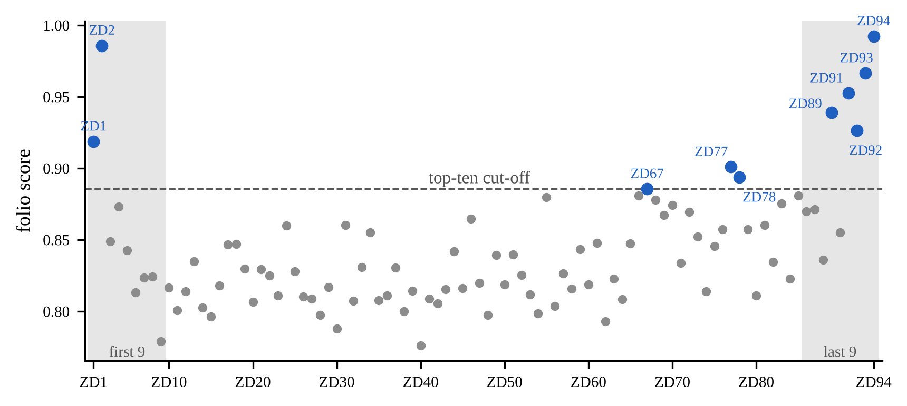

# Computational Codicology via Thermal Diffusion
### Visualizing Material Anomalies in Lanten Religious Manuscripts

This repository contains the screening pipeline, figures and a summary of results for a study of a Kim Mun (Lanten / Indigo Yao) manuscript of the secret words, *Zhai duan miyu* 齋短秘語 (ninety-four main-text folios, ZD1–ZD94, in the author's collection). Every folio is screened with the vision model **vHeat** and scored against the rest of the codex; the high-scoring regions are then examined codicologically.

vHeat detects visual heterogeneity; it does not identify wear. All computational results are meant to direct, not replace, codicological examination and close reading.

- **[Summary of results](./report.md)**
- **[Scripts](./scripts/)**
- **[Figures and folio index](./case-examples/)**

---

## Pipeline

The procedure and all parameters were fixed in writing before any results were examined.

| Step | Script | What it does |
|---|---|---|
| 1 | `scripts/extract_features.py` | Resizes each folio to 896 × 1344 px and cuts it into 24 tiles of 224 × 224 px; combines features from the second and third stages of vHeat-base and pools them into a grid of 84 × 56 cells per folio (each cell ≈ one third of a written character); fixed random projection to 192 dimensions (seed 1234). |
| 2 | `scripts/score.py` | Scores each cell by its distance to the most similar of 40,000 cells drawn from all other folios (PatchCore-style nearest neighbour, seed 2026). The folio itself and the two folios on either side are excluded from the reference, so that show-through shared by neighbouring leaves is not treated as normal. A folio's score is the 99th percentile of its cell scores after a 6% margin on every edge is excluded. |
| 3 | `scripts/make_maps.py` | Draws, for every folio, the original scan, a heat map on a colour scale shared by all folios, and the cells above the manuscript-wide 99th percentile; also writes an overview sheet and an index table. |

### Model configuration

The released vHeat-base checkpoint was trained with layer scale (1e-5) and post-norm. Build the model with `layer_scale=1e-5, post_norm=True` and load the weights with `strict=True` (see `scripts/vheat_loader.py`). The loader should report `<All keys matched successfully>`; a non-strict load would drop the 48 layer-scale parameters without raising an error.

### Quick start

```bash
pip install -r requirements.txt
git clone https://github.com/MzeroMiko/vHeat.git          # model code
# download the vHeat-base weights (vHeat_base.pth) from the vHeat repository

cd scripts
python extract_features.py --images /path/to/folio_images --vheat_repo /path/to/vHeat --weights /path/to/vHeat_base.pth --out feats.npz
python score.py --feats feats.npz --out scores.npz --csv folio_scores.csv
python make_maps.py --images /path/to/folio_images --scores scores.npz --out maps
```

Folio images are expected to be named `ZD_<n>.png`. The pipeline is deterministic: a complete rerun reproduces the stored features and cell scores exactly. The manuscript images themselves are not included in this repository.

---

## Main results

- Scores fall with distance from the two ends of the manuscript (Spearman ρ = −0.40, p < 0.001). Seven of the ten highest-scoring folios lie within the first or last nine (ZD1, ZD2, ZD89, ZD91–ZD94); no folio between ZD3 and ZD65 reaches the top ten.
- The gradient persists when only blank-paper or only written cells are scored, after the density of writing is controlled, after red-removal, and across variations of reference, percentile and random seed.
- On the outermost leaves the high-scoring cells follow water stains and creases, which a paper-tone measure does not register; the distribution records the codex's mode of storage.
- Read folio by folio, the visualizations also direct attention to passages concealed with red pigment (ZD63) and to a correction (ZD51).

See **[report.md](./report.md)** for details.



---

## Attribution

This project builds on the vHeat visual backbone:

> Wang, Zhaozhi, Yue Liu, Yunjie Tian, Yunfan Liu, Yaowei Wang, and Qixiang Ye. 2025. "Building Vision Models upon Heat Conduction." In *Proceedings of the IEEE/CVF Conference on Computer Vision and Pattern Recognition (CVPR)*, 9707–9717.

```bibtex
@InProceedings{Wang_2025_CVPR,
    author    = {Wang, Zhaozhi and Liu, Yue and Tian, Yunjie and Liu, Yunfan and Wang, Yaowei and Ye, Qixiang},
    title     = {Building Vision Models upon Heat Conduction},
    booktitle = {Proceedings of the IEEE/CVF Conference on Computer Vision and Pattern Recognition (CVPR)},
    year      = {2025},
    pages     = {9707--9717}
}
```

The cell scoring follows the nearest-neighbour approach of PatchCore: Roth, Karsten, et al. 2022. "Towards Total Recall in Industrial Anomaly Detection." *CVPR*, 14318–14328.

## Citation

Wei, Xiang. "Computational Codicology via Thermal Diffusion: Visualizing Material Anomalies in Lanten Religious Manuscripts." Short paper submitted to DH2027, Galway. Code: https://github.com/xiangbuddha/Vheat-codicology
