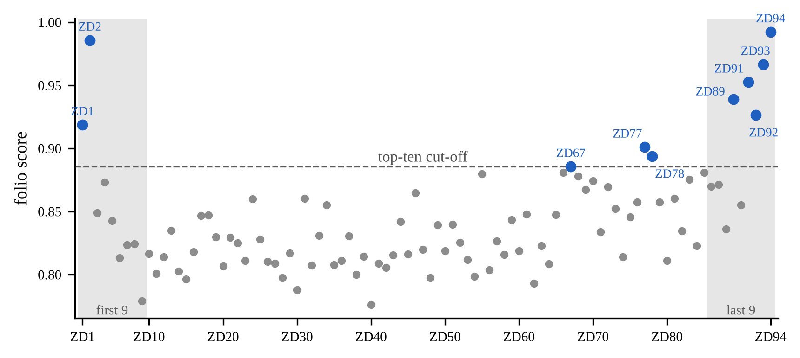
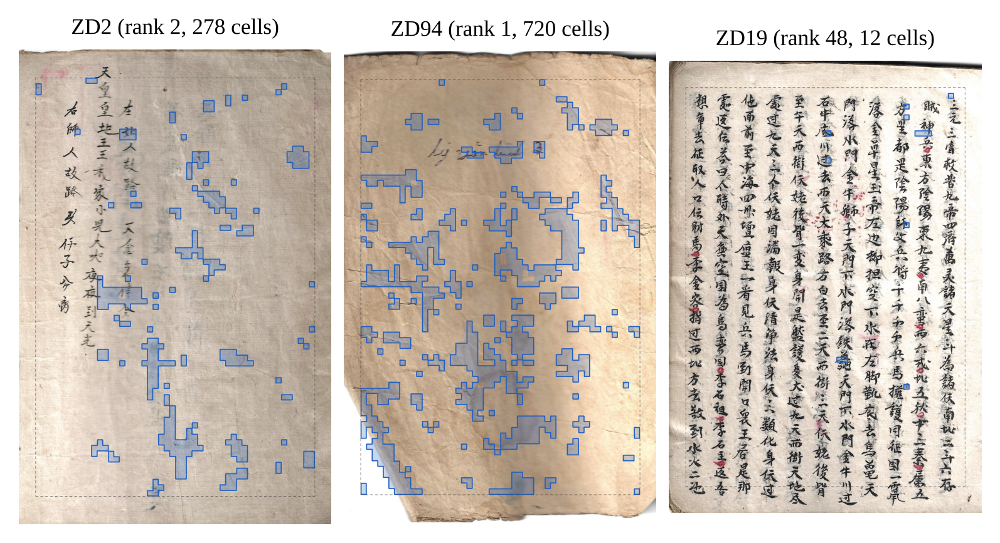
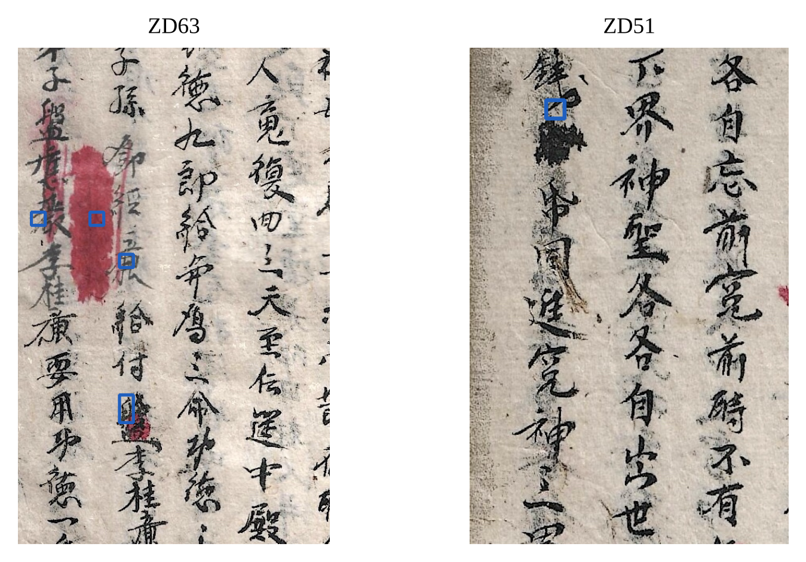

# Summary of results

*Zhai duan miyu* 齋短秘語, a Kim Mun (Lanten) manuscript of the secret words: a cover and ninety-four main-text folios (ZD1–ZD94), thread-bound in the *tongzi ye* 筒子頁 format on thin paper with frequent show-through, purchased from an antiquarian bookseller in Hanoi. Each folio was captured with a flatbed scanner, so all images were acquired under the same lighting and geometric conditions.

For the specialist, a manuscript of the secret words functions as a ritual implement, picked up, opened, and worked with on each ritual occasion. Because a *miyu* is assembled from rearrangeable, individually titled units and need not be recited in full in any single rite, the material condition of its pages is inherently uneven. Visual inspection is selective: it is drawn to red seals, dense writing, and sections already expected to matter. To determine which parts of a manuscript were most often drawn upon, every folio must be surveyed on the same terms. The screening pipeline in this repository does that; the high-scoring regions are then examined codicologically.

## Full-manuscript distribution

*Figure 1. Folio scores for ZD1 to ZD94 in folio order; seven of the ten highest (blue) fall in the shaded outer leaves.*

- Scores fall with distance from the two ends of the manuscript (Spearman ρ = −0.40, p < 0.001). The ten highest-scoring folios are ZD94, ZD2, ZD93, ZD91, ZD89, ZD92, ZD1, ZD77, ZD78 and ZD67. No folio between ZD3 and ZD65 reaches the top ten, and most folios remain largely quiet: half carry thirteen or fewer cells above the manuscript-wide 99th percentile.
- The outer folios carry less writing (ρ = 0.40), yet the gradient persists when only blank-paper cells (ρ = −0.40) or only written cells (ρ = −0.40) are scored, and after the density of writing is controlled (partial ρ = −0.30).
- After red-removal, nine of the ten candidates remain in the top ten and the gradient persists (ρ = −0.34). Across variations of reference, percentile, and seed, the same seven outer folios stay in the top ten.
- A paper-tone measure, which registers overall darkening rather than localized concentration, points to only one end: eight of its ten darkest folios lie between ZD80 and ZD94, while ZD2 and ZD1, second and seventh in the screening, rank 50th and 60th in tone.

## The outer leaves

*Figure 2. Cells above the manuscript-wide 99th percentile (blue) on ZD2, ZD94, and ZD19 (median score); dashed line, excluded margin.*

The edges of this manuscript are generally aged and soiled, a condition that reflects its mode of storage: the secret words were folded, rolled up, and wrapped in a cloth cover. In such a codex, the first and last leaves lie closest to the wrapping and are most exposed to folding, rolling, and damp. On ZD2 and ZD94, the high-scoring cells follow water stains and creases rather than particular characters. The concentration of anomalies at the two ends is consistent with this history of storage; it records damage to the codex as an object, not the use of particular units. Some of it may have occurred after the manuscript passed out of the hands of its original owner.

Of the other three candidates, ZD67, within the unit 道士辰時專延生幡撥糧之法, enters the top ten in only two of seven variants; ZD77 and ZD78 remain in all seven, but ZD78 falls just outside the top ten after red-removal. On ZD67 and ZD77, half or more of the high-scoring cells lie near the excluded margin. I record them without making any determination about use. From around ZD80 onward, the handwriting also becomes progressively more cursive.

## Screening as systematic review

*Figure 3. Details of ZD63 and ZD51, marked as in Figure 2.*

Beyond the outer leaves, the folio-by-folio visualizations direct attention to passages concealed with red pigment on ZD63, where a red line runs through 鄧經廉, and to a correction at the far left of ZD51.

The workflow uses computation to discipline scholarly attention while reserving causal judgment for material examination. The model does not make the leaves speak. It disciplines the conditions under which their marks can be read.

## Files

- `case-examples/figures/`: the three figures above and an overview of all ninety-four folios in folio order (`overview_all_folios.jpg`).
- `case-examples/maps/`: a three-panel map for every folio (original scan, heat on a shared colour scale, cells above the manuscript-wide 99th percentile); see `case-examples/README.md`.
- `case-examples/folio_index.csv`: score, rank, rank after red-removal, number of cells above the manuscript-wide 99th percentile, share of those cells near the excluded margin, and share of inked cells for every folio.
